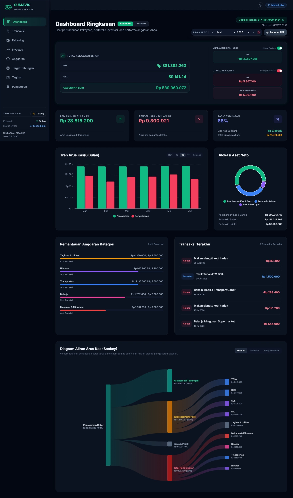
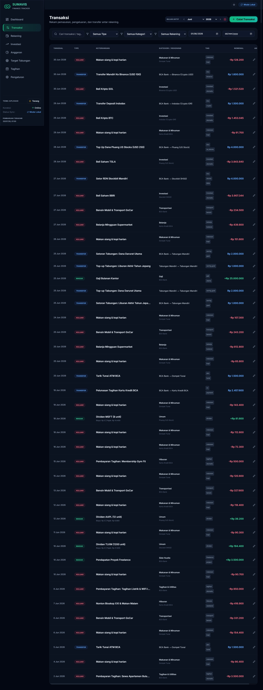
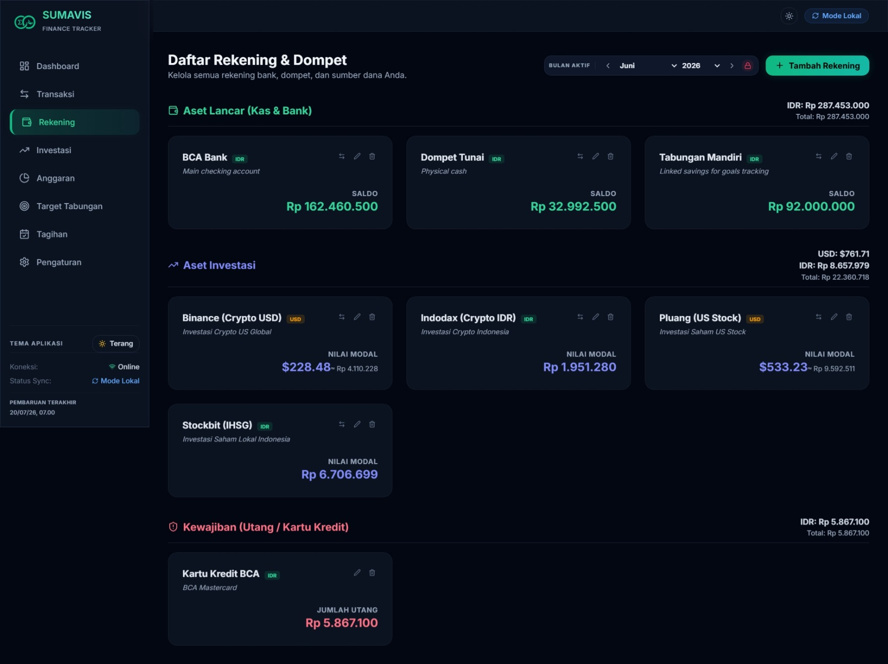
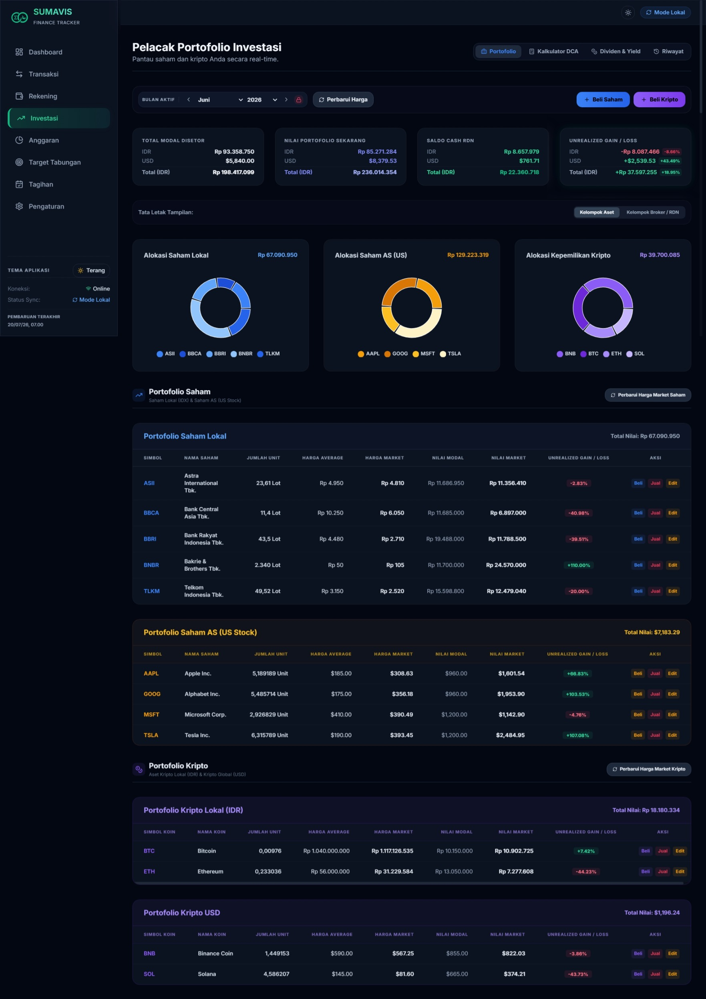
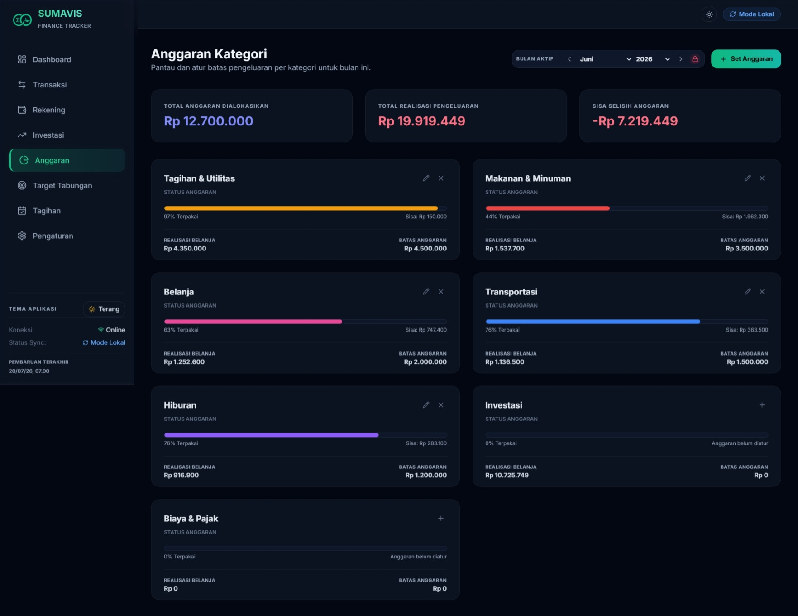
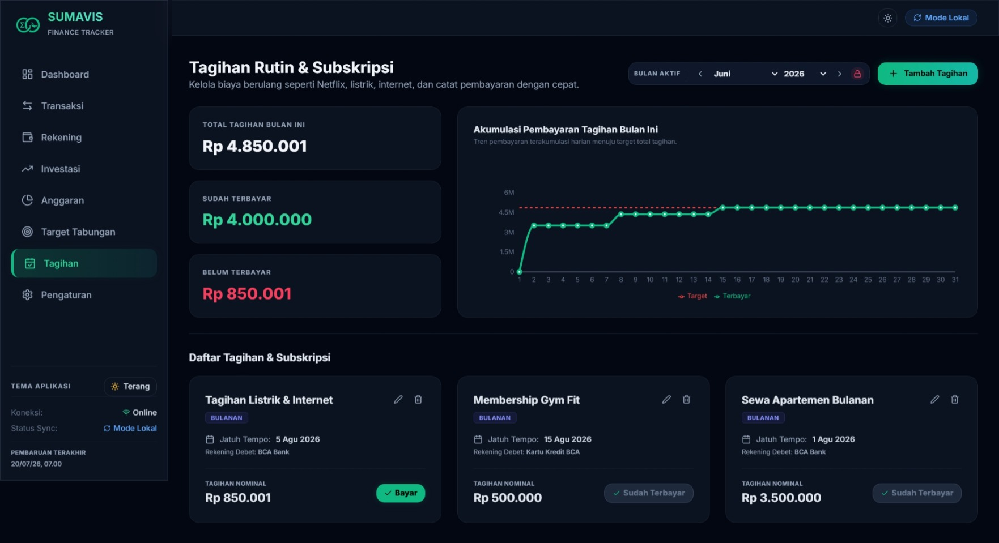
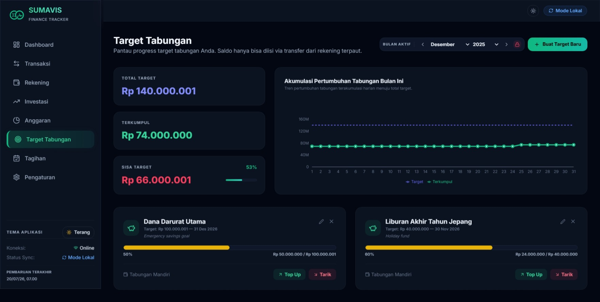
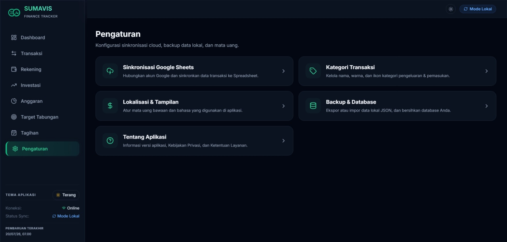
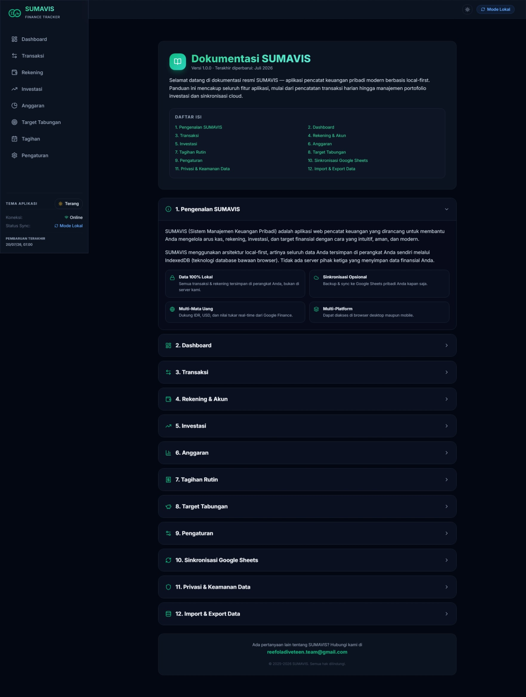

<div align="center">
  

  <h1>SUMAVIS</h1>
  <p><strong>Summary of Asset, Value, Investment & Spending</strong></p>
  <p>A modern, <em>local-first</em> personal finance tracker with optional two-way sync to Google Sheets.</p>

  <p>
    
    
    
    
    
    
  </p>
</div>

---

## 📋 Table of Contents

- [About SUMAVIS](#-about-sumavis)
- [Key Features](#-key-features)
- [Screenshots](#-screenshots)
- [Tech Stack](#-tech-stack)
- [Getting Started](#-getting-started)
- [Project Structure](#-project-structure)
- [Google Sheets Sync](#-google-sheets-sync)
- [Privacy & Security](#-privacy--security)
- [Localization (i18n)](#-localization-i18n)
- [License](#-license)

---

## 🧩 About SUMAVIS

**SUMAVIS** is a web-based personal finance tracker designed with a **local-first** philosophy — all your data is stored locally on your device using IndexedDB (via Dexie), rather than on third-party servers.

It is specifically tailored to support modern financial workflows:
- 💱 **Multi-Currency Support**: Manage accounts, transactions, and investment portfolios in major currencies (**IDR**, **USD**) as well as **15+ other global & regional currencies** (such as SGD, EUR, GBP, JPY, AUD, CAD, CHF, CNY, HKD, KRW, MYR, THB, PHP, INR, VND). Exchange rates are dynamically converted using real-time rates fetched from Google Finance. Historical balance reconstruction remains accurate across all currencies.
- 🤖 **AI Vision Multimodal Intelligence**: Integrated smart AI engine supporting **Gemini**, **OpenAI**, **9router**, **OpenRouter**, and local **Ollama Vision** models. Effortlessly import stock/crypto portfolio holdings, m-Banking & e-Wallet account balances, and shopping/transfer receipts via screenshot uploads or direct `Ctrl+V` clipboard paste.
- 🗣️ **Multi-Language Support (i18n)**: User-friendly interface with full support for **Indonesian** and **English**. All labels, tooltips, hints, and in-app documentation automatically change according to your selected language.
- 🌓 **Flexible Themes**: Full support for **Dark Mode**, **Light Mode**, or follow your OS **System** preference.
- ☁️ **Google Sheets Sync**: Secure backup and two-way synchronization to your personal Google Drive spreadsheet.

---

## ✨ Key Features

| Feature | Description |
|---|---|
| 🤖 **AI Vision Assist** | Automatically scan screenshots of stock/crypto portfolios (Stockbit, Ajaib, Bibit, Pintu, IPOT), m-Banking/e-Wallet balances (BCA, Mandiri, GoPay, OVO), and physical/digital transaction receipts via Gemini, OpenAI, 9router, OpenRouter, or local Ollama with `Ctrl+V` paste support. |
| 📊 **Dashboard** | Unified Net Worth, dynamic Sankey cashflow diagrams, monthly/yearly trend charts, PDF report export, and a quick **Scan Struk AI** shortcut button. |
| 💸 **Transactions** | Record spending, income, and transfers between accounts with support for tags, categories, admin fees, taxes, and instant AI receipt scanning. |
| 🏦 **Accounts & Wallets** | Manage asset accounts, cash wallets, credit cards (liabilities), and broker RDN cash in various global currencies. Includes AI screenshot scanning for m-Banking and e-Wallet balances. |
| 📈 **Investments** | Monitor holdings of Stocks (IDR local 4-tick / US USD market) and Crypto (IDR/USD) with average purchase price calculations, real-time Floating PnL, and AI Vision screenshot portfolio table import. Includes a dedicated **Dividends & Yield Tracker** to monitor cumulative dividend payouts and Yield on Cost (YoC). |
| 💰 **Budgets** | Set monthly or yearly budget limits per category, complete with visual progress bars and warning notifications when approaching limits. |
| 🔔 **Recurring Bills** | Track recurring payments (weekly, monthly, yearly) with a one-click payment recording feature. |
| 🎯 **Saving Goals** | Set specific saving targets (vacation, emergency fund, etc.) integrated directly with transfer transactions, target savings accounts, and completion confetti. |
| ☁️ **Sync Google Sheets** | Secure personal cloud backup via Google Sheets API v4 & OAuth 2.0. |
| 💱 **Dynamic Multi-Currency** | Automatic conversion of multi-currency balances based on current exchange rates with an instant manual refresh button. |
| 🌐 **Multi-Language (i18n)** | Dynamic translation system based on a CSV file for easy addition of new languages. |
| 🔒 **100% Private** | No data collection on third-party servers, no ad trackers, your data belongs fully to you. |

---

## 📸 Screenshots

### Dashboard
> Complete financial summary: Net Worth, cash flow trend, Sankey diagram, and annual report.



---

### Transactions
> Record, filter, and search all financial activities with ease.



---

### Accounts & Wallets
> Manage all bank accounts, cash wallets, credit cards, and investment brokers.



---

### Investments
> Stock and crypto portfolios with Floating PnL, transaction history, and RDN cash balance.



---

### Budgets
> Plan and monitor spending limits per category every month.



---

### Recurring Bills
> Track all recurring bills and record payments directly from the app.



---

### Saving Goals
> Establish financial goals and save money in a structured way.



---

### Settings
> Customize language, theme, categories, and manage data (import/export/sync).



---

### Documentation
> Comprehensive guide for using all features directly inside the application.



---

## 🛠 Tech Stack

| Layer | Technology |
|---|---|
| **Framework** | [React 18](https://react.dev/) + [TypeScript](https://www.typescriptlang.org/) |
| **Build Tool** | [Vite 5](https://vitejs.dev/) |
| **Local Database** | [Dexie.js](https://dexie.org/) (IndexedDB wrapper) |
| **Routing** | [React Router v6](https://reactrouter.com/) (HashRouter) |
| **Charts** | [Recharts](https://recharts.org/) |
| **Icons** | [Lucide React](https://lucide.dev/) |
| **Styling** | Vanilla CSS + Tailwind CSS utility classes |
| **Fonts** | [Outfit](https://fonts.google.com/specimen/Outfit) (Google Fonts) |
| **Cloud Sync** | Google Sheets API v4 + OAuth 2.0 |
| **i18n** | Custom CSV-based translation system (`public/translations.csv`) |

---

## 🚀 Getting Started

### Prerequisites
- [Node.js](https://nodejs.org/) v18 or later
- [npm](https://npmjs.com/) v9 or later

### Installation & Local Run

```bash
# 1. Clone the repository
git clone https://github.com/Reefoldfiveteen/sumavis.git
cd sumavis

# 2. Install dependencies
npm install

# 3. Run the development server
npm run dev
```

Open your browser and navigate to `http://localhost:5173`.

### Production Build

```bash
npm run build
npm run preview
```


## 📁 Project Structure

```
sumavis/
├── public/
│   ├── logo.svg                  # Application logo
│   ├── translations.csv          # Translation catalog (ID/EN)
│   ├── seed-data.json            # Dummy data for demo
│   └── auto-seed.html            # Auto-import page for dummy data
├── src/
│   ├── components/               # Reusable UI components
│   │   ├── Layout.tsx            # Main layout + navigation sidebar
│   │   ├── MonthSelector.tsx     # Month selector dropdown
│   │   └── Portal.tsx            # Modal portal helper
│   ├── context/
│   │   ├── DbContext.tsx         # Dexie DB setup and data seeding
│   │   ├── FinanceContext.tsx    # Finance calculations and balance reconstruction
│   │   └── UIContext.tsx         # App theme, language, and translation context
│   ├── db/
│   │   └── db.ts                 # Dexie schema and typescript interfaces
│   ├── pages/
│   │   ├── Dashboard.tsx         # Main dashboard page
│   │   ├── Transactions.tsx      # Transactions manager
│   │   ├── Accounts.tsx          # Accounts/wallets manager
│   │   ├── Investments.tsx       # Stock and crypto portfolio
│   │   ├── Budgets.tsx           # Category budgets manager
│   │   ├── Bills.tsx             # Recurring bills manager
│   │   ├── SavingGoals.tsx       # Saving targets manager
│   │   ├── Settings.tsx          # App settings and Google sync controls
│   │   ├── Documentation.tsx     # In-app user documentation
│   │   ├── PrivacyPolicy.tsx     # Privacy policy document
│   │   └── TermsOfService.tsx    # Terms of service document
│   ├── services/
│   │   └── googleSheets.ts       # Google Sheets integration and OAuth service
│   └── utils/
│       └── formatters.ts         # Formatting tools (currency, dates, etc.)
├── OTHER/
│   └── new_dummy_db.json         # Complete dummy database
├── docs/
│   └── screenshots/              # Screenshots for the README
└── scratch/
    └── generate_dummy.js         # Script to generate dummy database entries
```

---

## ☁️ Google Sheets Sync

SUMAVIS supports optional two-way synchronization (**two-way sync**) to your personal Google Sheets via **OAuth 2.0**.

### How to Enable

1. Navigate to **Settings** → **Google Sheets Sync**
2. Click **"Connect with Google"** and follow the authorization prompt
3. Select or create the spreadsheet you wish to sync with
4. Click **"Sync Now"**

### Synced Entities

- ✅ Accounts & Wallets
- ✅ Transactions
- ✅ Categories
- ✅ Budgets
- ✅ Recurring Bills
- ✅ Saving Goals
- ✅ Stock & Crypto Portfolios
- ✅ Investment Transaction History

> **Conflict Resolution:** SUMAVIS uses a timestamp-based resolver (`updated_at`). The latest update wins, enabling safe sync across multiple devices.

---

## 🔒 Privacy & Security

SUMAVIS is built with a **privacy by design** mindset:

- 🔐 **No Storage Servers**: All your financial data remains in your device's browser database (IndexedDB). No external servers ever touch your details.
- 🚫 **No Trackers or Ads**: The application does not load third-party analytics scripts, tracking pixels, or advertisement SDKs.
- 🔑 **Minimal OAuth Scope**: The authorization flow only requests access to the specific spreadsheet file created by SUMAVIS on your Google Drive.
- 🌐 **Direct API Calls**: All Google API requests are made directly from your browser to Google endpoints. No intermediate servers or proxies are used.

---

## 🌐 Localization (i18n)

SUMAVIS uses a lightweight CSV-based localization model:

```
public/translations.csv   ←  Format: key;id;en
```

Example row:
```csv
key;id;en
dashboard;Dashboard;Dashboard
net_worth;Total Kekayaan Bersih;Total Net Worth
```

To add new language options, simply append a new column to this CSV and update `UIContext.tsx`.

---

## 📄 License

```
MIT License

Copyright (c) 2025–2026 SUMAVIS

Permission is hereby granted, free of charge, to any person obtaining a copy
of this software and associated documentation files (the "Software"), to deal
in the Software without restriction, including without limitation the rights
to use, copy, modify, merge, publish, distribute, sublicense, and/or sell
copies of the Software, and to permit persons to whom the Software is
furnished to do so, subject to the following conditions:

The above copyright notice and this permission notice shall be included in all
copies or substantial portions of the Software.

THE SOFTWARE IS PROVIDED "AS IS", WITHOUT WARRANTY OF ANY KIND, EXPRESS OR
IMPLIED, INCLUDING BUT NOT LIMITED TO THE WARRANTIES OF MERCHANTABILITY,
FITNESS FOR A PARTICULAR PURPOSE AND NONINFRINGEMENT. IN NO EVENT SHALL THE
AUTHORS OR COPYRIGHT HOLDERS BE LIABLE FOR ANY CLAIM, DAMAGES OR OTHER
LIABILITY, WHETHER IN AN ACTION OF CONTRACT, TORT OR OTHERWISE, ARISING FROM,
OUT OF OR IN CONNECTION WITH THE SOFTWARE OR THE USE OR OTHER DEALINGS IN THE
SOFTWARE.
```

---

<div align="center">
  <p>SUMAVIS Finance Tracker 💵</p>
  <p>
    <a href="https://sumavis.vercel.app/#/documentation">📖 Documentation</a> ·
    <a href="https://sumavis.vercel.app/#/privacy-policy">🔒 Privacy Policy</a> ·
    <a href="https://sumavis.vercel.app/#/terms-of-service">📋 Terms of Service</a>
  </p>
</div>
